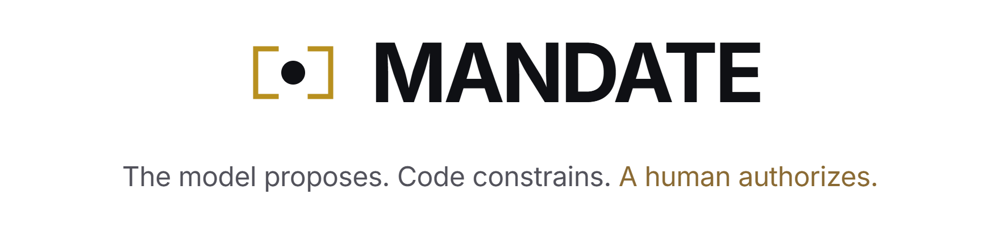
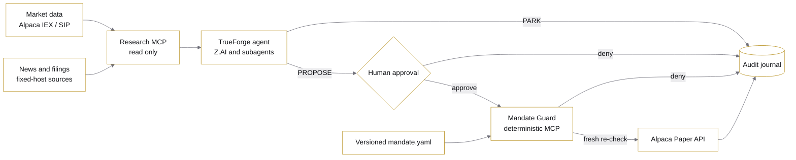

<p align="center">
  <picture>
    <source media="(prefers-color-scheme: dark)" srcset="docs/readme/banner.dark.png">
    
  </picture>
</p>

<p align="center">
  An operator lets an autonomous agent watch the market around the clock, and a paper order goes out
  only after they approve it and deterministic code proves it fits their written mandate.
</p>

<p align="center">
  <!-- readme:buttons -->
  <a href="https://harn.miposts.com"><picture><source media="(prefers-color-scheme: dark)" srcset="docs/readme/cta-live.dark.png"></picture></a>
  <a href="#run-locally"><picture><source media="(prefers-color-scheme: dark)" srcset="docs/readme/cta-run.dark.png"></picture></a>
  <a href="docs/MANDATE_VERIFICATION.md"><picture><source media="(prefers-color-scheme: dark)" srcset="docs/readme/cta-docs.dark.png"></picture></a>
  <!-- /readme:buttons -->
</p>

<p align="center">
  <!-- readme:status -->
  <a href="#how-it-works"><picture><source media="(prefers-color-scheme: dark)" srcset="docs/readme/badge-status-1.dark.png"></picture></a>
  <a href="docs/MANDATE_VERIFICATION.md"><picture><source media="(prefers-color-scheme: dark)" srcset="docs/readme/badge-status-2.dark.png"></picture></a>
  <br>
  <a href="docs/evidence/paper-e2e-2026-08-27.json"><picture><source media="(prefers-color-scheme: dark)" srcset="docs/readme/badge-status-3.dark.png"></picture></a>
  <a href="docs/architecture.md#safety-invariants"><picture><source media="(prefers-color-scheme: dark)" srcset="docs/readme/badge-status-4.dark.png"></picture></a>
  <a href="LICENSE"><picture><source media="(prefers-color-scheme: dark)" srcset="docs/readme/badge-status-5.dark.png"></picture></a>
  <!-- /readme:status -->
</p>

<p align="center">
  <!-- readme:stack -->
  <picture><source media="(prefers-color-scheme: dark)" srcset="docs/readme/badge-stack-1.dark.png"></picture>
  <picture><source media="(prefers-color-scheme: dark)" srcset="docs/readme/badge-stack-2.dark.png"></picture>
  <picture><source media="(prefers-color-scheme: dark)" srcset="docs/readme/badge-stack-3.dark.png"></picture>
  <br>
  <picture><source media="(prefers-color-scheme: dark)" srcset="docs/readme/badge-stack-4.dark.png"></picture>
  <picture><source media="(prefers-color-scheme: dark)" srcset="docs/readme/badge-stack-5.dark.png"></picture>
  <!-- /readme:stack -->
</p>

<p align="center">
  <!-- readme:nav -->
  <a href="#why-it-exists"><picture><source media="(prefers-color-scheme: dark)" srcset="docs/readme/badge-nav-1.dark.png"></picture></a>
  <a href="#how-it-works"><picture><source media="(prefers-color-scheme: dark)" srcset="docs/readme/badge-nav-2.dark.png"></picture></a>
  <a href="#try-it-in-two-minutes"><picture><source media="(prefers-color-scheme: dark)" srcset="docs/readme/badge-nav-3.dark.png"></picture></a>
  <a href="#results"><picture><source media="(prefers-color-scheme: dark)" srcset="docs/readme/badge-nav-4.dark.png"></picture></a>
  <a href="#run-locally"><picture><source media="(prefers-color-scheme: dark)" srcset="docs/readme/badge-nav-5.dark.png"></picture></a>
  <a href="#structure"><picture><source media="(prefers-color-scheme: dark)" srcset="docs/readme/badge-nav-6.dark.png"></picture></a>
  <a href="#limitations"><picture><source media="(prefers-color-scheme: dark)" srcset="docs/readme/badge-nav-7.dark.png"></picture></a>
  <!-- /readme:nav -->
</p>

<p align="center">
  
  <br>
  <sub>Public safety rehearsal: the agent proposes one order, the card lists every guard check that passed before approval.</sub>
</p>

> **The model never holds a trading endpoint.** Orders exist only as calls to the Mandate Guard, which
> owns the paper broker credentials, re-reads the mandate and the account immediately before submit,
> and denies anything outside the limits, even after a human approved it.

## Why it exists

Giving an LLM a broker API creates an authority problem, not a prediction problem. A persuasive model
response is no proof that an order respects position limits, current exposure, market hours, the loss
budget or the operator's intent.

MANDATE separates intelligence from authority. **The agent researches and proposes, a human approves,
and the guard executes only what a versioned YAML mandate allows.** Every prepared, denied and
submitted event is journaled with the SHA-256 fingerprint of the mandate that was in force.

## How it works



<table>
<tr>
<td valign="top" width="33%">

**1. Approval resumes, it never overrides**

Human approval only resumes the paused tool call. The guard then repeats every policy check on its
own, so an approved order outside the mandate is still denied.

<sub>`npm run eval:approval`: a denial leaves the guard journal byte-identical</sub>

</td>
<td valign="top" width="33%">

**2. Fresh state, fail closed**

Right before submit the guard re-reads the account, broker clock, latest trade, pending orders and
every limit with `Decimal`. Stale data, a closed session, a malformed mandate or an unknown rule
deny execution.

<sub>91 guard tests in `mandate/mcp-guard/tests`</sub>

</td>
<td valign="top" width="33%">

**3. Retries cannot duplicate an order**

Canonical intent fingerprints and stable client IDs with durable broker provenance make a retry
idempotent: an unchanged retry is deduplicated, a mutated one is rejected.

<sub>Recorded in the [paper E2E artifact](docs/evidence/paper-e2e-2026-08-27.json)</sub>

</td>
</tr>
</table>

## Try it in two minutes

Open the [public rehearsal](https://harn.miposts.com) and sign in as `demo` / `MandateDemo2026`. The
shared profile is isolated: no production account values, secrets or trajectory controls.

| | What to do | What you see |
|---|---|---|
| 1 | Open the pending decision card | Symbol, size, limit price, the rationale and every guard check that passed |
| 2 | Approve the rehearsal order | The completed card moves into the journal, positions and exposure update |
| 3 | Deny the next proposal | Nothing reaches the broker, the journal records the denial |

How the dashboard, the news view and chat as the control plane work is described in the
[architecture](docs/architecture.md#product-experience).

## Results

The repository ships executable probes, not just architecture claims. Each line names the command and
what it proves; wider runtime evidence is in the [verification report](docs/MANDATE_VERIFICATION.md).

| Probe | What it proves |
|---|---|
| `npm run eval:sandbox` | Deterministic Code Mode works without touching MCP or approval |
| `npm run eval:subagents` | Two isolated read-only subagents delegate without execution authority |
| `npm run eval:approval` | An irreversible tool pauses; denial leaves the guard journal byte-identical |
| `npm run eval:research-e2e` | TrueForge and Z.AI use bounded research tools and produce no broker write |
| `MANDATE_E2E_ALLOW=true npm run eval:paper-e2e` | Supervised paper submit, durable provenance and idempotent retry |
| `npm run eval:cancel-e2e` | Exact-ID cancellation requires submitted guard provenance |

The sanitized [paper E2E artifact](docs/evidence/paper-e2e-2026-08-27.json) records a real Alpaca paper
flow: `prepared → submitted`, official broker readback, an unchanged retry producing `deduplicated`, and
an approval-gated cancellation.

**Where it stops.** Backtests use point-in-time inputs, fees, spread-crossing slippage and a
frozen-parameter holdout. Their output is engineering evidence, not a profitability claim.

## Run locally

Needs Python 3.11+, Node.js 22 or 24, an Alpaca **paper** account and a Z.AI API key.

```bash
cp mandate/.env.example mandate/.env
```

Then start the guard, research MCP, dashboard, TrueForge and the autonomy runner as separate supervised
processes. Default ports: guard `8010`, research `8020`, dashboard API `8030`, TrueForge and UI `8790`.

<details>
<summary><b>Install, test and start every service</b></summary>
<br>

```bash
cd mandate/mcp-guard
python -m venv .venv
source .venv/bin/activate
python -m pip install -e '.[test]'
python -m pytest

cd ../../mandate/research
python -m pip install -e '.[test]'
python -m pytest
```

```bash
cd mandate/app
npm install
npm run typecheck
npm run build

cd ../agent
npm install
npm run typecheck
npm run eval:autonomy
```

```bash
mandate-guard
MANDATE_RESEARCH_TRANSPORT=streamable-http mandate-research-mcp
mandate-dashboard

cd mandate/agent
npm run apply
npm run autonomy
```

Deployment keeps MCP and dashboard services on loopback and exposes only the authenticated HTTPS
operator UI. Never commit `mandate/.env`.

</details>

## Structure

Three deliberately unequal trust zones: an unprivileged research plane, a creative but untrusted agent
plane, and a deterministic execution plane. The key decision, whether an order reaches the broker, is
made only in the Mandate Guard.

```text
mandate/
├── agent/          TrueForge spec, 24/7 runner and executable E2E probes
├── app/            React operator dashboard and agent workspace
├── mandates/       Human-owned, versioned authority
├── mcp-guard/      Deterministic execution boundary and audit journal
└── research/       Read-only signals, news, monitoring, sizing and backtests
```

| Document | What is inside |
|---|---|
| [Architecture](docs/architecture.md) | Trust zones, strategies and news scoring, safety invariants, the TrueForge harness, product experience |
| [Example mandate](mandate/mandates/example.yaml) | The human-authored policy the guard executes |
| [Verification report](docs/MANDATE_VERIFICATION.md) | Every requirement with its status and authoritative evidence |
| [Qodo review log](docs/QODO_REVIEW_LOG.md) | Commit-linked code review history and project rules |

## Limitations

- **Paper trading only.** The guard accepts exactly `https://paper-api.alpaca.markets`; there is no
  live-money path, and paper results do not transfer to live markets.
- **Not investment advice.** Strategies and backtests are engineering evidence; nothing here forecasts
  or promises profit.
- **Not production-ready.** Live use would need an independent security review, regulatory analysis,
  operational controls and validation beyond this repository.

<p align="center">
  <picture><source media="(prefers-color-scheme: dark)" srcset="docs/readme/mark.dark.png"></picture>
  <br>
  <sub>Team Ullax, 2026. Licensed under <a href="LICENSE">MIT</a>.</sub>
</p>
